# Esquema entidad-relación · Crocanti (Neon PostgreSQL)

## Diagrama

```mermaid
erDiagram
    usuarios {
        int id PK
        text nombre
        text correo UK
        text clave
        text rol
    }

    productos {
        int id PK
        text nombre
        text categoria
        numeric precio
        text descripcion
        text imagen_emoji
        text imagen_url
        boolean disponible
        boolean en_promocion
        text uuid_operation UK
    }

    promociones {
        int id PK
        int producto_id FK
        numeric descuento_porcentaje
        boolean activa
        text uuid_operation UK
    }

    pedidos {
        int id PK
        text numero_orden
        numeric total
        text tienda
        int tienda_id FK
        int usuario_id FK
        text tipo_pago
        text codigo_operacion
        text direccion_entrega
        text estado
        text fecha
        text uuid_operation UK
    }

    detalle_pedido {
        int id PK
        int pedido_id FK
        int producto_id FK
        text nombre_producto
        int cantidad
        numeric precio_unitario
        numeric subtotal
    }

    tiendas {
        int id PK
        text nombre UK
        text direccion
        text telefono
        boolean activa
    }

    sync_operaciones {
        text uuid_operation PK
        text entidad
        text tipo_operacion
        int id_remoto
        int id_local
        timestamptz procesado_en
    }

    usuarios ||--o{ pedidos : "usuario_id"
    tiendas ||--o{ pedidos : "tienda_id"
    pedidos ||--o{ detalle_pedido : "pedido_id"
    productos ||--o{ detalle_pedido : "producto_id"
    productos ||--o{ promociones : "producto_id"
    productos ||..o{ sync_operaciones : "id_local / id_remoto (lógico)"
```

## Cardinalidades

| Relación | Cardinalidad | Regla de borrado |
|---|---|---|
| `usuarios` → `pedidos` | 1 usuario : N pedidos (0..1 por pedido) | `SET NULL` |
| `tiendas` → `pedidos` | 1 tienda : N pedidos (0..1 por pedido) | `SET NULL` |
| `pedidos` → `detalle_pedido` | 1 pedido : N líneas (1..N) | `CASCADE` |
| `productos` → `detalle_pedido` | 1 producto : N líneas (0..1 por línea) | `SET NULL` |
| `productos` → `promociones` | 1 producto : N promociones | `CASCADE` |
| `sync_operaciones` | Sin FK: bitácora lógica por `entidad` + `id_local`/`id_remoto` | — |

## Diccionario de datos

### `usuarios`

| Columna | Tipo | Nulo | Default | Clave / nota |
|---|---|---|---|---|
| `id` | `SERIAL` | No | auto | PK |
| `nombre` | `TEXT` | No | — | Nombre visible |
| `correo` | `TEXT` | No | — | UNIQUE; login de ambas apps |
| `clave` | `TEXT` | No | — | Texto plano (legado) |
| `rol` | `TEXT` | No | `'cliente'` | `administrador` / `cliente` |

### `productos`

| Columna | Tipo | Nulo | Default | Clave / nota |
|---|---|---|---|---|
| `id` | `SERIAL` | No | auto | PK |
| `nombre` | `TEXT` | No | — | UNIQUE por `lower(trim(nombre))` tras ejecutar `002_dedupe_productos.sql` |
| `categoria` | `TEXT` | No | — | Filtro del menú |
| `precio` | `NUMERIC(10,2)` | No | — | `CHECK (precio >= 0)` |
| `descripcion` | `TEXT` | No | `''` | — |
| `imagen_emoji` | `TEXT` | No | `''` | Icono de la app |
| `imagen_url` | `TEXT` | Sí | `NULL` | Imagen opcional |
| `disponible` | `BOOLEAN` | No | `TRUE` | Visibilidad en catálogo |
| `en_promocion` | `BOOLEAN` | No | `FALSE` | Marca de oferta |
| `uuid_operation` | `TEXT` | Sí | `NULL` | UNIQUE; idempotencia del sync |

### `promociones`

| Columna | Tipo | Nulo | Default | Clave / nota |
|---|---|---|---|---|
| `id` | `SERIAL` | No | auto | PK |
| `producto_id` | `INTEGER` | No | — | FK → `productos.id`, `ON DELETE CASCADE` |
| `descuento_porcentaje` | `NUMERIC(5,2)` | No | — | `CHECK BETWEEN 0 AND 100` |
| `activa` | `BOOLEAN` | No | `TRUE` | — |
| `uuid_operation` | `TEXT` | Sí | `NULL` | UNIQUE; idempotencia del sync |

### `pedidos`

| Columna | Tipo | Nulo | Default | Clave / nota |
|---|---|---|---|---|
| `id` | `SERIAL` | No | auto | PK |
| `numero_orden` | `TEXT` | No | — | Código mostrado al cliente |
| `total` | `NUMERIC(10,2)` | No | `0` | `CHECK (total >= 0)` |
| `tienda` | `TEXT` | No | `''` | Texto original (compatibilidad) |
| `tienda_id` | `INTEGER` | Sí | `NULL` | FK → `tiendas.id`, `ON DELETE SET NULL` |
| `usuario_id` | `INTEGER` | Sí | `NULL` | FK → `usuarios.id`, `ON DELETE SET NULL` |
| `tipo_pago` | `TEXT` | No | `'Efectivo'` | — |
| `codigo_operacion` | `TEXT` | No | `''` | Pago con código |
| `direccion_entrega` | `TEXT` | No | `''` | Delivery |
| `estado` | `TEXT` | No | `'PENDIENTE'` | `PENDIENTE`, `ENTREGADO`, etc. |
| `fecha` | `TEXT` | No | `''` | Android envía `dd/MM/yyyy HH:mm` |
| `uuid_operation` | `TEXT` | Sí | `NULL` | UNIQUE; idempotencia del sync |

### `detalle_pedido`

| Columna | Tipo | Nulo | Default | Clave / nota |
|---|---|---|---|---|
| `id` | `SERIAL` | No | auto | PK |
| `pedido_id` | `INTEGER` | No | — | FK → `pedidos.id`, `ON DELETE CASCADE` |
| `producto_id` | `INTEGER` | Sí | `NULL` | FK → `productos.id`, `ON DELETE SET NULL` |
| `nombre_producto` | `TEXT` | No | `''` | Copia histórica del nombre |
| `cantidad` | `INTEGER` | No | — | `CHECK (cantidad > 0)` |
| `precio_unitario` | `NUMERIC(10,2)` | No | — | `CHECK (precio_unitario >= 0)` |
| `subtotal` | `NUMERIC(12,2)` | No | generado | `GENERATED ALWAYS AS (cantidad * precio_unitario) STORED` |

Restricción: `UNIQUE (pedido_id, producto_id)`.

### `tiendas`

| Columna | Tipo | Nulo | Default | Clave / nota |
|---|---|---|---|---|
| `id` | `SERIAL` | No | auto | PK |
| `nombre` | `TEXT` | No | — | UNIQUE por `lower(nombre)` |
| `direccion` | `TEXT` | Sí | `NULL` | — |
| `telefono` | `TEXT` | Sí | `NULL` | — |
| `activa` | `BOOLEAN` | No | `TRUE` | — |

### `sync_operaciones`

| Columna | Tipo | Nulo | Default | Clave / nota |
|---|---|---|---|---|
| `uuid_operation` | `TEXT` | No | — | PK; idempotencia |
| `entidad` | `TEXT` | No | — | `producto`, `promocion` |
| `tipo_operacion` | `TEXT` | No | — | `INSERT`, `UPDATE`, `DELETE` |
| `id_remoto` | `INTEGER` | Sí | `NULL` | Id real en Neon |
| `id_local` | `INTEGER` | Sí | `NULL` | Id local de la app ADMIN |
| `procesado_en` | `TIMESTAMPTZ` | No | `NOW()` | Fecha de procesamiento |

## Índices y restricciones

| Nombre | Tabla | Definición |
|---|---|---|
| `ux_productos_uuid_operation` | `productos` | UNIQUE (`uuid_operation`) |
| `ux_productos_nombre_normalizado` | `productos` | UNIQUE (`lower(trim(nombre))`) — crear con `002_dedupe_productos.sql` |
| `ux_promociones_uuid_operation` | `promociones` | UNIQUE (`uuid_operation`) |
| `ix_promociones_producto_id` | `promociones` | (`producto_id`) |
| `ux_pedidos_uuid_operation` | `pedidos` | UNIQUE (`uuid_operation`) |
| `ix_pedidos_usuario_id` | `pedidos` | (`usuario_id`) |
| `ix_pedidos_tienda_id` | `pedidos` | (`tienda_id`) |
| `ux_tiendas_nombre` | `tiendas` | UNIQUE (`lower(nombre)`) |
| `ux_detalle_pedido_pedido_producto` | `detalle_pedido` | UNIQUE (`pedido_id`, `producto_id`) |
| `ix_detalle_pedido_pedido` | `detalle_pedido` | (`pedido_id`) |
| `ix_detalle_pedido_producto` | `detalle_pedido` | (`producto_id`) |
| `ix_sync_operaciones_entidad` | `sync_operaciones` | (`entidad`) |
| `ix_sync_operaciones_local` | `sync_operaciones` | (`entidad`, `id_local`) |

## Correspondencia con Room (apps Android)

| Neon | ADMIN (Room) | CLIENTE (Room) |
|---|---|---|
| `usuarios` | `usuarios` (`idRemoto`) | `usuarios` (`idRemoto`) |
| `productos` | `productos` (`idRemoto`) | `productos` (`idRemoto`) |
| `promociones` | `promociones` (`idRemoto`) | — |
| `pedidos` | — (se lee por API) | `pedidos` (`idRemoto`, `usuarioId`, `usuarioCorreo`) |
| `detalle_pedido` | — (se lee por API) | `detalle_pedido` |
| `tiendas` | — | — (lista fija en la app) |
| `sync_operaciones` | `operaciones_pendientes` (local) | `operaciones_pendientes` (local) |
| — | `sync_metadata` (local) | `sync_metadata` (local) |
| — | — | `carrito_items` (local) |

## Flujo de sincronización

1. ADMIN escribe en Room y encola en `operaciones_pendientes`.
2. `POST /api/sync` envía el lote; el backend registra cada `uuid_operation` en `sync_operaciones`.
3. Si la operación ya existe, se responde con el `id_remoto` guardado (idempotencia).
4. ADMIN guarda el `id_remoto` en su entidad local y lo usa en las siguientes operaciones.
5. CLIENTE crea el pedido local con `usuarioId`/`usuarioCorreo` y sus líneas.
6. `POST /api/pedidos` resuelve usuario y tienda, guarda cabecera + `detalle_pedido` en una transacción y devuelve el `id` remoto.
7. ADMIN consulta `GET /api/pedidos` para ver cliente, tienda y detalle.
8. CLIENTE descarga su historial desde `GET /api/pedidos` filtrando por el correo de la sesión y descarga `GET /api/promociones`.
9. Ambas apps sincronizan automáticamente mientras están visibles (sondeo cada 15–20 s) y en segundo plano con WorkManager.

## Migraciones

| Archivo | Cuándo ejecutarlo |
|---|---|
| `001_sync_neon.sql` | Primera instalación o actualización del esquema. |
| `002_dedupe_productos.sql` | Si ya existen productos repetidos por nombre. Limpia los duplicados, reasigna pedidos/promociones y crea el índice único por nombre normalizado. |
